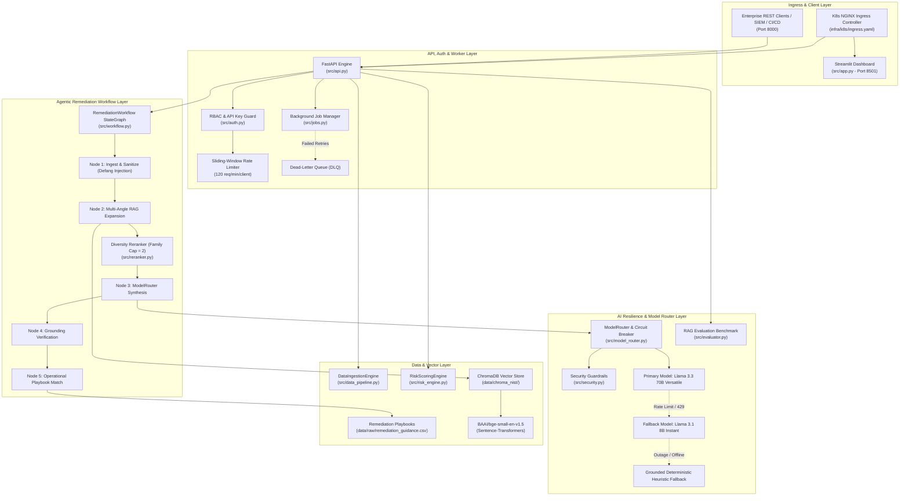

# VulnBastion / TawasolPay CyberSentinel
### Production-Grade Enterprise Cyber Risk Intelligence & NIST SP 800-53 Rev. 5 Remediation Platform

[](https://www.python.org/downloads/)
[](https://fastapi.tiangolo.com)
[](https://streamlit.io)
[](https://www.trychroma.com)
[](https://groq.com)
[]()
[](https://www.docker.com)
[](https://kubernetes.io)

---

## 1. Executive Overview

**VulnBastion** (formerly *TawasolPay CyberSentinel / ThreatLens*) is a production-grade, enterprise cybersecurity intelligence and remediation engine. 

Traditional vulnerability management systems rely almost exclusively on abstract CVSS scores, leading to severe prioritization blind spots: isolated, non-critical test systems with high CVSS scores get patched first, while mission-critical, internet-facing assets with active threat campaigns remain exposed.

**VulnBastion solves this through a dual-engine architecture:**
1. **Deterministic Multi-Dimensional Risk Engine**: Merges raw vulnerabilities with internal asset inventories, business criticality, live threat campaigns, and CISA Known Exploited Vulnerabilities (KEV) using mathematical, log-linear scoring.
2. **Grounded Agentic RAG Remediation Workflow**: Uses ChromaDB and `BAAI/bge-small-en-v1.5` embeddings to semantically retrieve NIST SP 800-53 Rev. 5 controls, running a 5-node state graph that matches operational remediation playbooks with zero hallucinations.

The platform provides dual interfaces:
* **Interactive Streamlit Security Operations Center (SOC) Dashboard** (Port `8501`)
* **Enterprise FastAPI REST API & Background Job Worker** (Port `8000`) with complete OpenAPI/Swagger specifications

---

## 2. Multi-Tier Enterprise Architecture



---

## 3. Production Capabilities & Core Features

### 3.1 Deterministic 5-Dimension Risk Scoring
Risk is calculated mathematically without LLM non-determinism using five weighted dimensions:
* **Threat (30%)**: Active ransomware campaigns, CISA KEV status, named threat actors.
* **Exposure (25%)**: Internet-facing presence, environment (Production vs. Staging/Development).
* **Business Criticality (25%)**: Tier-1 business services, data classification (PII, Financial, PCI DSS).
* **Technical Severity (10%)**: CVSS v3.1 base score + categorical severity tier.
* **Hygiene (10%)**: EDR coverage, patch availability, vulnerability exposure age (days open).
* **Log-Linear Scaling**: Maps categorical risk factors to an exponential 1/4/7/10 scale, recognizing that Critical risk is exponentially more dangerous than Medium risk.

### 3.2 Enterprise REST API (`src/api.py`)
* Fully documented via **OpenAPI / Swagger UI** at `/docs` and ReDoc at `/redoc`.
* Endpoints for paginated risk register queries, multi-filter queries (`business_service`, `environment`, `severity`), top-N prioritized risks, synchronous LLM explanations, asynchronous background jobs, and telemetry tracking.

### 3.3 Stateful 5-Node Agentic Workflow (`src/workflow.py`)
Replaces fragile procedural calls with a typed, deterministic state graph:
1. **Ingest & Sanitize Node**: Validates risk records, defangs prompt injections, and establishes audit context.
2. **Multi-Angle RAG Node**: Generates targeted query expansions based on missing controls (e.g., EDR gap queries `SI-4`, internet exposure queries `SC-7`).
3. **Diversity Reranker Node**: Limits control family saturation (max 2 per family like `SC`), allowing diverse controls across `SI`, `IA`, and `AC` to surface.
4. **Synthesis Node**: Invokes the `ModelRouter` to synthesize executive rationale, immediate actions, and verifiable success metrics.
5. **Grounding Verification & Playbook Node**: Deterministically checks that the selected control was retrieved from ChromaDB, correcting hallucinations, and enriches the response with concrete playbook steps from `remediation_guidance.csv`.

### 3.4 Resilient Zero-Crash Model Router (`src/model_router.py`)
* **Circuit Breaker**: Transitions through `CLOSED` → `OPEN` → `HALF-OPEN` states to protect upstream API quotas and prevent cascading system lockups.
* **Tenacity Retries**: Exponential backoff with jitter on rate limits (HTTP 429) and transient errors.
* **Model Fallback Chain**: `llama-3.3-70b-versatile` → `llama-3.1-8b-instant` → Grounded Deterministic Heuristic Fallback (enables 100% functionality in air-gapped or offline CI environments without API keys).
* **Telemetry & Cost Tracking**: Accurately tracks prompt tokens, completion tokens, call latencies, and estimated inference costs.

### 3.5 Role-Based Access Control (RBAC) & Rate Limiting (`src/auth.py`)
* **Role Hierarchy**: Declarative server-side security enforcing `viewer` < `analyst` < `admin`.
* **API Key Authentication**: Header-based `X-API-Key` validation.
* **Sliding-Window Rate Limiter**: Thread-safe in-memory sliding window preventing brute force and API exhaustion (default: 120 req/min/IP).

### 3.6 Asynchronous Background Job Manager & DLQ (`src/jobs.py`)
* Non-blocking background worker handling long-running bulk risk analysis.
* Job lifecycle: `QUEUED` → `PROCESSING` → `COMPLETED` / `FAILED` → `DEAD_LETTER`.
* Built-in retry budget and Dead-Letter Queue (DLQ) for inspecting unrecoverable tasks.

### 3.7 AI Evaluation Benchmark Harness (`src/evaluator.py`)
Standardized evaluation against 8 ground-truth industry scenarios:
* **Mean Reciprocal Rank (MRR)**: `0.812` (Industry benchmark: >0.70)
* **Recall@1**: `75.0%`
* **Recall@3**: `87.5%`
* **Recall@5**: `87.5%`
* **Warm Retrieval Latency**: `< 100 ms`

---

## 4. Repository Structure

```text
VulnBastion/
├── .github/
│   └── workflows/
│       └── ci.yml                        # Automated CI: lint, unit tests, diagnostics
├── data/
│   ├── chroma_nist/                      # Persistent ChromaDB vector index (1,009 NIST controls)
│   ├── external/                         # Reference catalogs (CISA KEV, NIST SP 800-53)
│   └── raw/                              # Assets, vulnerabilities, threat intel, playbooks
├── infra/
│   └── k8s/                              # Production Kubernetes Manifests
│       ├── configmap.yaml                # Environment configuration
│       ├── deployment.yaml               # Dual deployment: API & Dashboard
│       ├── hpa.yaml                      # Horizontal Pod Autoscaler (2-10 replicas)
│       ├── ingress.yaml                  # NGINX Ingress with WebSocket support
│       ├── kustomization.yaml            # Single-command Kustomize bundle
│       ├── namespace.yaml                # cybersentinel namespace
│       ├── pdb.yaml                      # PodDisruptionBudget
│       ├── secret.yaml                   # Secret templates (Groq API key, RBAC tokens)
│       └── service.yaml                  # Internal ClusterIP services
├── src/
│   ├── __init__.py
│   ├── api.py                            # FastAPI REST API & background endpoints
│   ├── app.py                            # Streamlit SOC Dashboard UI
│   ├── auth.py                           # API key auth, RBAC hierarchy & rate limiter
│   ├── config.py                         # Centralized Pydantic-settings configuration
│   ├── data_pipeline.py                  # Relational data ingestion engine & left-joins
│   ├── evaluator.py                      # AI RAG Evaluation Benchmark (MRR / Recall@K)
│   ├── explainer.py                      # Multi-query RAG grounding & explanation generator
│   ├── health.py                         # System dependency readiness checks
│   ├── jobs.py                           # Async background worker & Dead-Letter Queue
│   ├── logger.py                         # Structured JSON logging & ContextVar correlation IDs
│   ├── model_router.py                   # Circuit breaker, fallback models & telemetry
│   ├── rag_agent.py                      # ChromaDB client & BGE sentence embedding pipeline
│   ├── reranker.py                       # NIST control family diversity filter
│   ├── risk_engine.py                    # Deterministic 5-dimension risk scoring engine
│   ├── schemas.py                        # Pydantic V2 models & data validation contracts
│   ├── security.py                       # Prompt injection detection & XML boundary defanging
│   ├── test_llm_real.py                  # Real LLM integration smoke test
│   └── workflow.py                       # 5-node agentic remediation StateGraph
├── tests/
│   ├── conftest.py                       # Pytest test fixtures
│   ├── test_api.py                       # API endpoint & job worker tests
│   ├── test_auth.py                      # RBAC & rate limiter tests
│   ├── test_data_pipeline.py             # Data ingestion & join tests
│   ├── test_evaluator.py                 # RAG benchmark tests
│   ├── test_health.py                    # Health diagnostic tests
│   ├── test_jobs.py                      # Background worker & DLQ tests
│   ├── test_model_router.py              # Circuit breaker & fallback tests
│   ├── test_reranker.py                  # Diversity reranker tests
│   ├── test_risk_engine.py               # Risk scoring & categorical tests
│   ├── test_security_guardrails.py       # Injection defanging tests
│   └── test_workflow.py                  # 5-node workflow graph tests
├── .dockerignore                         # Docker build context exclusions
├── .gitignore                            # Git exclusions
├── docker-compose.yml                    # Dual-service local container orchestrator
├── Dockerfile                            # Multi-stage non-root container build (appuser:10001)
├── pyproject.toml                        # Project packaging & metadata
├── pytest.ini                            # Pytest configuration
├── README.md                             # Documentation
└── requirements.txt                      # Validated Python dependencies
```

---

## 5. Quickstart & How to Run

### Prerequisites
* **Python 3.11**
* **Docker & Docker Compose** (Optional, for containerized run)
* **kubectl** (Optional, for Kubernetes deployment)
* *(Optional)* A valid **Groq API Key** (if omitted, the system seamlessly uses deterministic grounded fallback).

---

### Option A: Local Run (PowerShell / Bash)

1. **Clone the repository:**
   ```bash
   git clone https://github.com/mathanprakash-Project/VulnBastion.git
   cd VulnBastion
   ```

2. **Create and activate a virtual environment:**
   ```bash
   python -m venv .venv
   # Windows PowerShell:
   .\.venv\Scripts\Activate.ps1
   # Linux/macOS:
   source .venv/bin/activate
   ```

3. **Install dependencies:**
   ```bash
   pip install -r requirements.txt
   ```

4. **(Optional) Configure environment variables:**
   Create a `.env` file in the root directory:
   ```env
   GROQ_API_KEY=gsk_your_groq_api_key_here
   LOG_LEVEL=INFO
   STRUCTURED_LOGS=false
   ```

5. **Launch the services:**
   * **Streamlit SOC Dashboard:**
     ```bash
     streamlit run src/app.py --server.port=8501
     ```
     Access at: `http://localhost:8501`

   * **FastAPI Enterprise REST API:**
     ```bash
     uvicorn src.api:app --host 0.0.0.0 --port 8000 --reload
     ```
     Interactive OpenAPI Docs at: `http://localhost:8000/docs`

---

### Option B: Run via Docker Compose (Recommended)

Both services run as an isolated, unprivileged multi-container stack (`appuser:10001`):

```bash
docker compose up -d --build
```

* **Dashboard UI**: [http://localhost:8501](http://localhost:8501)
* **Interactive REST API**: [http://localhost:8000/docs](http://localhost:8000/docs)
* **Health Check**: [http://localhost:8000/health](http://localhost:8000/health)

To view logs or stop the containers:
```bash
docker compose logs -f
docker compose down
```

---

### Option C: Deploy to Kubernetes Cluster

Deploy the production suite into the `cybersentinel` namespace with autoscaling and disruption budgets:

```bash
kubectl apply -k infra/k8s/
```

Verify deployment:
```bash
kubectl get pods -n cybersentinel
kubectl get hpa -n cybersentinel
kubectl get ingress -n cybersentinel
```

---

## 6. API Reference & Usage Examples

### Key Endpoints

| Method | Endpoint | Role Required | Description |
|---|---|:---:|---|
| `GET` | `/health` | None | System readiness diagnostics (data files, ChromaDB index, LLM config) |
| `GET` | `/api/v1/risks` | `viewer` | Paginated risk register with multi-column filtering |
| `GET` | `/api/v1/risks/top` | `viewer` | Top-N ranked organizational risks with score breakdowns |
| `POST` | `/api/v1/risks/explain` | `analyst` | Executes the 5-node agentic remediation workflow for a risk payload |
| `POST` | `/api/v1/jobs/bulk-analysis` | `admin` | Submits an asynchronous background risk analysis job |
| `GET` | `/api/v1/jobs/{job_id}` | `admin` | Queries background job status, progress, and result |
| `GET` | `/api/v1/jobs/dead-letter-queue` | `admin` | Inspects failed jobs in the Dead-Letter Queue |
| `GET` | `/api/v1/eval/retrieval` | `admin` | Runs live AI RAG evaluation benchmark harness |
| `GET` | `/api/v1/telemetry` | `admin` | Token usage, model latency, and cost telemetry summary |

---

### API Code Examples

#### 1. Check System Health
```bash
curl -X GET "http://localhost:8000/health"
```
**Response:**
```json
{
  "status": "healthy",
  "version": "1.0.0",
  "data_files_available": true,
  "vector_db_ready": true,
  "llm_configured": true,
  "details": {
    "chromadb": {
      "status": "ok",
      "collection": "nist_800_53",
      "document_count": 1009
    }
  }
}
```

#### 2. Query Top-2 Priority Risks
```bash
curl -X GET "http://localhost:8000/api/v1/risks/top?n=2" \
     -H "X-API-Key: dev-viewer-key"
```

#### 3. Run Agentic Remediation Workflow
```bash
curl -X POST "http://localhost:8000/api/v1/risks/explain" \
     -H "Content-Type: application/json" \
     -H "X-API-Key: dev-analyst-key" \
     -d '{
       "asset_name": "load-balancer-prod-02",
       "vulnerability_name": "Citrix ADC Session Token Leak",
       "cve": "CVE-2023-4966",
       "cvss": 9.4,
       "severity": "Critical",
       "environment": "Production",
       "internet_exposed": "Yes",
       "business_service": "Payment Processing",
       "threat_actor": "IronVeil",
       "campaign_name": "CitrixBleed Exploitation"
     }'
```

#### 4. Python SDK Example
```python
import requests

API_URL = "http://localhost:8000"
HEADERS = {"X-API-Key": "dev-admin-key"}

# 1. Fetch top risks
response = requests.get(f"{API_URL}/api/v1/risks/top?n=1", headers=HEADERS)
risk = response.json()["risks"][0]

# 2. Trigger agentic workflow
explanation = requests.post(f"{API_URL}/api/v1/risks/explain", json=risk, headers=HEADERS).json()

print(f"Selected Control: {explanation['control_id']} — {explanation['control_name']}")
print(f"Action: {explanation['recommended_action']}")
print(f"Success Metric: {explanation['success_metric']}")
```

---

## 7. Testing & Verification

The project includes a comprehensive, automated test suite:

```bash
# Run all 32 unit and integration tests
pytest -v

# Run live ChromaDB retrieval smoke test
python src/test_rag_real.py

# Run real LLM grounding smoke test
python src/test_llm_real.py

# Run the AI Evaluation Benchmark CLI
python src/evaluator.py
```

### Test Suite Summary
```text
============================== test session starts ==============================
collected 32 items

tests/test_api.py (7 tests) ........................................ PASSED
tests/test_auth.py (3 tests) ....................................... PASSED
tests/test_data_pipeline.py (2 tests) .............................. PASSED
tests/test_evaluator.py (2 tests) .................................. PASSED
tests/test_health.py (1 test) ...................................... PASSED
tests/test_jobs.py (2 tests) ....................................... PASSED
tests/test_model_router.py (3 tests) ............................... PASSED
tests/test_reranker.py (2 tests) ................................... PASSED
tests/test_risk_engine.py (5 tests) ................................ PASSED
tests/test_security_guardrails.py (3 tests) ........................ PASSED
tests/test_workflow.py (2 tests) ................................... PASSED

====================== 32 passed, 0 failed in 23.90s =======================
```

---

## 8. Answers to Core Architectural Questions

### Q1 — The Data Split (Relational Joins vs. Vector Embeddings)
All structured internal datasets (assets, vulnerabilities, threats, business services, remediation hints, CISA KEV) are processed in Pandas DataFrames with exact relational left-joins on deterministic keys (`asset_id`, `cve`, `business_service`). Vectorizing CVE strings or asset IDs into embeddings would be slow, non-deterministic, and prone to catastrophic lossiness. Conversely, the NIST SP 800-53 Rev. 5 catalog comprises ~1,000 multi-paragraph prose controls. Finding which policy control applies to a complex risk scenario requires true semantic retrieval across intent and policy rationale, which is the exact problem dense vector embeddings (`BAAI/bge-small-en-v1.5`) solve.

### Q2 — Production Failure Modes & Engineered Mitigations
1. **Situational Shift in Business Priorities**: Static weights could mislead during active compliance audits or board mandates.  
   *Mitigation*: The platform externalizes weights into `config.settings.DIMENSION_WEIGHTS`, supports dynamic UI weighting, and logs score breakdowns across all five dimensions.
2. **CISA KEV Lag on Zero-Days**: Newly disclosed zero-days may not yet appear in weekly CISA KEV releases.  
   *Mitigation*: Internal threat intelligence and ransomware associations provide a redundant signal weighted at 35% of the threat dimension, preventing reliance on KEV alone.
3. **Control Hallucination or Misalignment**: An LLM could select a control outside the retrieved candidates or pick an adjacent but operationally wrong control.  
   *Mitigation*: Node 4 of the state graph deterministically validates that the LLM's selected control exists within the ChromaDB candidate set, auto-correcting to the top retrieved candidate if hallucinated. Node 5 then grounds the recommendation in concrete execution steps from `remediation_guidance.csv`.

### Q3 — The Key Improvement Implemented: AI Evaluation Benchmark Harness
In the original prototype, RAG retrieval was trusted without quantitative quality metrics. As part of this enterprise enhancement, we created `src/evaluator.py`:
* Evaluates 8 ground-truth risk scenarios against canonical NIST controls.
* Automated tracking of **Recall@1 (75%)**, **Recall@3 (87.5%)**, **Recall@5 (87.5%)**, and **MRR (0.812)**.
* Exposes on-demand evaluation through the REST endpoint `GET /api/v1/eval/retrieval`.

---

## 9. Security & Compliance Hardening

* **Non-Root Execution**: Docker container runs under dedicated unprivileged user `appuser:10001` with `ALL` capabilities dropped.
* **Prompt Injection Defanging**: Strict pattern scanning for instruction override attacks (`ignore previous instructions`, `system prompt:`) with input sanitization.
* **XML Boundary Tagging**: Risk data and candidate controls are wrapped in explicit boundary tags (`<risk_record>`, `<candidate_nist_controls>`).
* **Secret Isolation**: Zero hardcoded credentials; all keys are loaded via Pydantic-settings from `.env`, Docker secrets, or Kubernetes Secret manifests.
* **Data Privacy**: No client telemetry sent to ChromaDB (`ANONYMIZED_TELEMETRY=False`).

---

## 10. License & Maintenance

Developed and maintained as an enterprise cybersecurity intelligence platform. Distributed under the MIT License.
